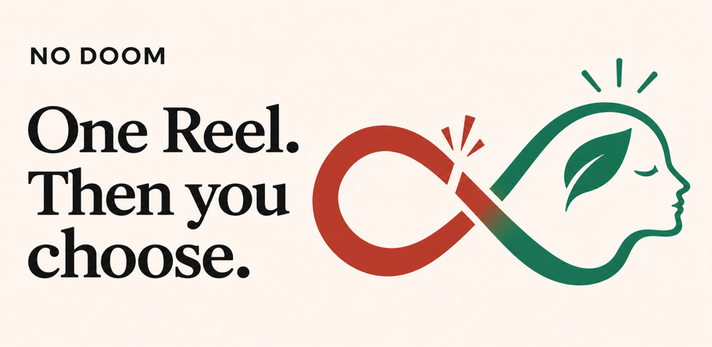
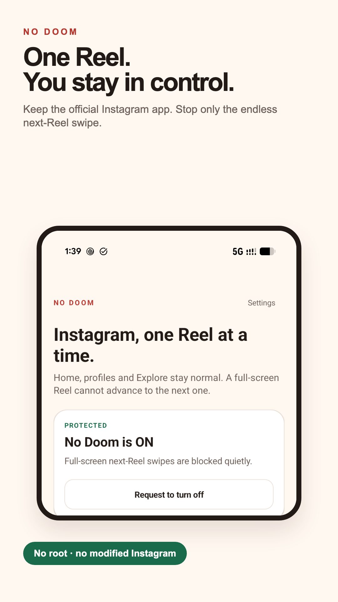
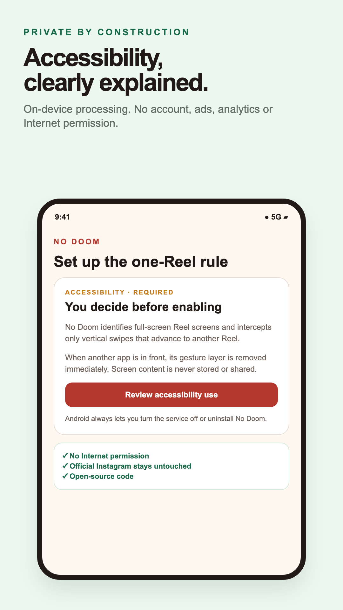
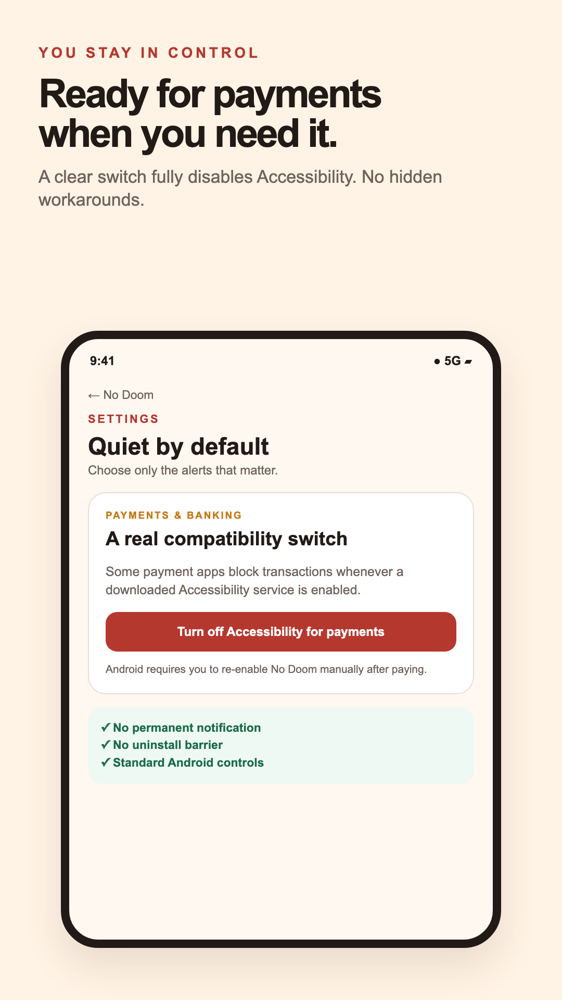

# No Doom

**Use the official Instagram app—without falling into the infinite Reels feed.**

No Doom is an open-source Android companion app that lets you watch one full-screen Reel, then blocks the swipe to the next Reel. Home, Explore, profiles and the official Instagram app stay intact.



<p align="center">
  
  
  
</p>

## Download for Android

### [⬇️ Download No Doom APK](https://github.com/chandsharma/nodoom/releases/latest/download/NoDoom.apk)

**Current version:** `1.0.0` · **Requires:** Android 14 or newer

[View release notes and checksums](https://github.com/chandsharma/nodoom/releases/latest) · [Changelog](CHANGELOG.md) · [Read the installation guide](docs/INSTALL.md)

This is the owner-signed, Google Play-ready release. Complete the in-app live check after installation and after Instagram updates.

- No root, bootloader unlock, patched APK, clone, or unofficial Instagram client.
- Works alongside the official Instagram app installed from Google Play.
- No Instagram login and no Instagram or Meta API access.
- No Internet permission, ads, analytics, telemetry, or cloud account.
- A 60-minute cooling-off period plus a 10-minute confirmation window makes impulsive disabling harder.

> [!IMPORTANT]
> No Doom is a real daily-use app under active development, not a tutorial project. The one-Reel engine passed its focused Pixel 9 Pro regression for sustained Home scrolling—including full-height inline Reels—Reels-to-Home transitions, reopening Instagram, the one-Reel gate, native controls, modal scrolling and System UI isolation. Version 1.0 adds a Play-policy-compliant Accessibility disclosure, standard uninstall, API 36 targeting and payment compatibility; always run the in-app live check after Instagram updates.

## What it changes

| Place | Behaviour |
|---|---|
| Home, Explore, profiles, DMs, stories, comments | Unchanged; scrolling works normally |
| A Reel you intentionally open | Plays normally; controls remain available |
| Swipe to another Reel | Blocked |
| Instagram Reels tab | Its first Reel can play; vertical swipes cannot advance |
| Android notification shade and Quick Settings | Always pass through normally |
| Other apps | Gesture layer and Reel session are removed immediately; their window content is not inspected |

No Doom uses Android Accessibility to recognise a full-screen Reel and intercept only the vertical gesture that would advance it. App-specific recognition is isolated behind [`ProtectedAppModule.java`](app/src/main/java/com/chandsharma/nodoom/ProtectedAppModule.java); Instagram's rules live in [`InstagramUiClassifier.java`](app/src/main/java/com/chandsharma/nodoom/InstagramUiClassifier.java). This keeps window safety independent and makes a future platform module possible without rewriting the core service.

## Safety and privacy

Instagram remains the Play Store-signed app and handles every login, video, message, like, comment, and network request. No Doom does not contact Instagram and does not perform social actions for you.

The release manifest intentionally has **no `INTERNET` permission**. Foreground package transitions are observed only to remove a stale gate when you switch apps; window structure is inspected in memory solely for Instagram and System UI safety. Release builds do not store captions, messages, usernames, images, or accessibility-tree dumps. No Doom never blocks disabling or uninstalling. See the [public privacy policy](https://chandsharma.github.io/nodoom/privacy/) and [Architecture](docs/ARCHITECTURE.md).

## Install

No Doom is being submitted to Google Play. Until the listing is approved, owner-signed APKs remain available on this repository's [GitHub Releases](https://github.com/chandsharma/nodoom/releases), together with SHA-256 checksums. Follow the [plain-language installation guide](docs/INSTALL.md). Google Play Protect may block a browser/file-manager installation of an Accessibility app in selected markets even when the APK is clean and correctly signed; never disable Play Protect to work around it.

Never install an APK posted in an issue, discussion, comment, mirror, or chat. Use only this repository's Releases page and verify its checksum.

## Build from source

Requirements:

- JDK 17
- Android SDK Platform 36 and Build Tools 36.0.0
- Android Studio or the command-line SDK tools

```bash
./gradlew test assembleDebug
```

The debug APK is written to `app/build/outputs/apk/debug/`. Release signing is deliberately local and the owner's key is never committed. The owner can build the signed artifact with `./scripts/build-owner-release.sh`; see [Releasing](docs/RELEASING.md).

## Current milestone

The project follows five gates:

1. **M0 feasibility:** validate every entry point and compare gesture suppression with bounce-back on the Pixel 9 Pro.
2. **M1 Reel blocking:** pass all Reel and unaffected-screen tests.
3. **M2 lock:** validate the 60-minute countdown and 10-minute window.
4. **M3 setup and user control:** validate disclosure, payment compatibility, standard uninstall and reboot paths.
5. **M4 hardening:** battery, memory, privacy, upgrade and one-week daily-use test.

Progress and evidence are tracked in [the feasibility report](docs/FEASIBILITY.md) and [test report](docs/TEST_REPORT.md). A checkbox is not marked passed without a real-device observation.

## Contributing

Contributions are welcome—especially accessibility snapshots that omit personal text, translations, Pixel compatibility fixes, UI tests and careful reviews of false-positive risks. Please read [CONTRIBUTING.md](CONTRIBUTING.md) before opening a pull request.

Useful labels and GitHub topics: `android`, `digital-wellbeing`, `doomscrolling`, `instagram`, `accessibility-service`, `open-source`, `productivity`, `pixel`.

## Licence

Apache-2.0. Instagram is a trademark of Meta Platforms, Inc. No Doom is an independent project and is not affiliated with or endorsed by Instagram or Meta.

